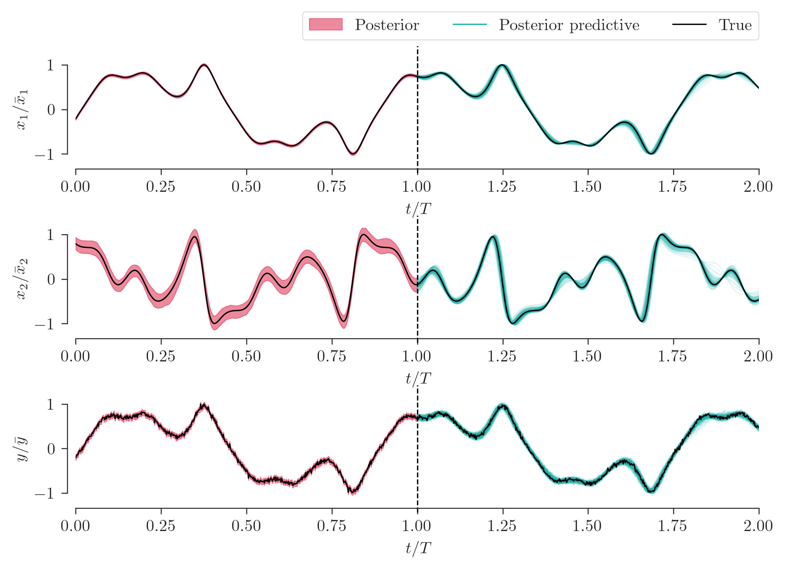
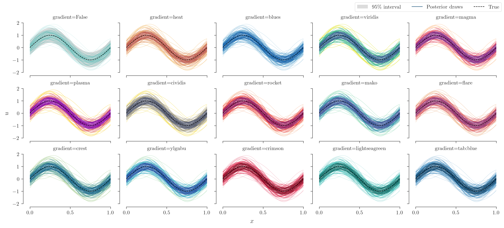
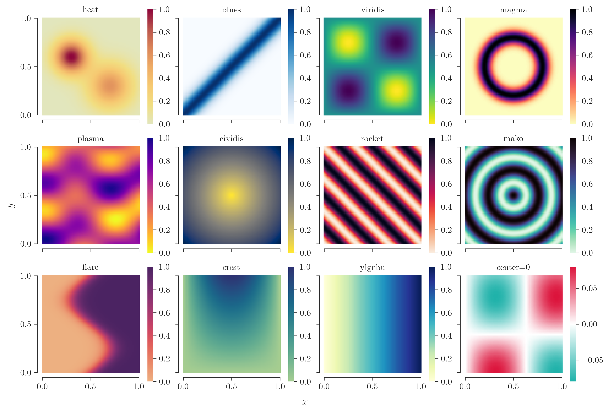
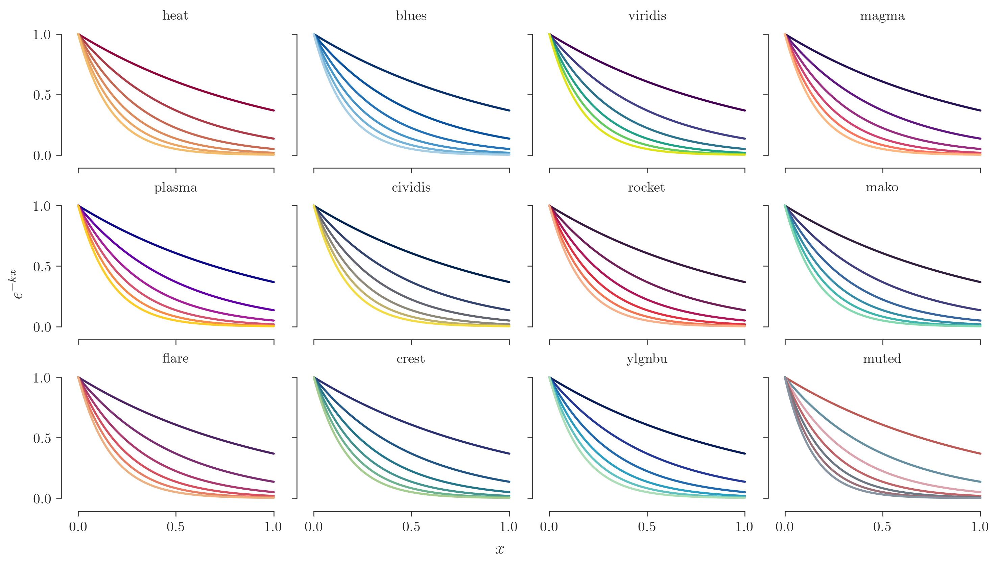

# labfigs

One plotting library for the lab's figures, with a house style modelled on Kairui Hao's thesis figures.
It is matplotlib and seaborn underneath: one style call, plus helpers for the elements that keep coming back (posterior bands, sample draws, method ribbons, intervals, heatmaps, colour ramps).
A Claude Code skill in `skill/` teaches an agent to use it, so figures look the same in every project.

## Install

```bash
git clone https://github.com/Jacob-Liam-Albaugh/labfigs.git
```

```bash
pip install -e labfigs
```

Text is set with LaTeX when `latex` is on your PATH, and with matplotlib's own math text otherwise.

In a `uv` project, use it without adding it to the project's dependencies:

```bash
uv run --with-editable path/to/labfigs python scripts/plot.py
```

## Use

```python
import numpy as np
import labfigs as lf

lf.use()
x = np.linspace(0, 1, 200)
truth = np.sin(2 * np.pi * x)
samples = truth * np.random.default_rng(0).normal(1, 0.2, (500, 1))

fig, ax = lf.subplots()
lf.paths(ax, x, samples, label="Posterior draws")
ax.plot(x, truth, color=lf.TRUE, ls="--", label="True")
ax.set(xlabel="$x$", ylabel="$u$", xticks=[0, 0.5, 1], yticks=[-2, -1, 0, 1, 2])
lf.legend_above(ax)
lf.save(fig, "out/first")
```

This writes `out/first.pdf` and `out/first.png`. The rules:

- Call `lf.use()` once, before any figure. Do not set fonts, sizes or `rcParams` yourself.
- Make figures with `lf.subplots` and finish them with `lf.save`.
- Use the named colours (`lf.POSTERIOR`, `lf.PREDICTIVE`, `lf.REFERENCE`, `lf.TRUE`), the cycle (`"C0"`, `"C1"`, ...) for methods, and `lf.ramp(n, name)` for ordered sweeps. No hex colours in scripts.
- If a figure needs something the library lacks, add a helper to `labfigs.py` instead of writing it in your script.

The full list of helpers, options and conventions is in [skill/SKILL.md](skill/SKILL.md).

## Examples

```bash
python examples/duffing_311.py
```

```bash
python examples/field.py
```

```bash
python examples/palettes.py
```

Each writes its figure next to the script.

The thesis Fig. 3.11 layout (`duffing_311.py`):



Sample draws, flat and shaded by standard deviations from the mean in every ramp (`field.py`):



A 2D field in every ramp (`field.py`):



Every ramp as a line sweep (`palettes.py`):



## Claude Code skill

Link the skill once and Claude Code will use the library whenever it plots:

```bash
ln -s "$PWD/labfigs/skill" ~/.claude/skills/labfigs
```
