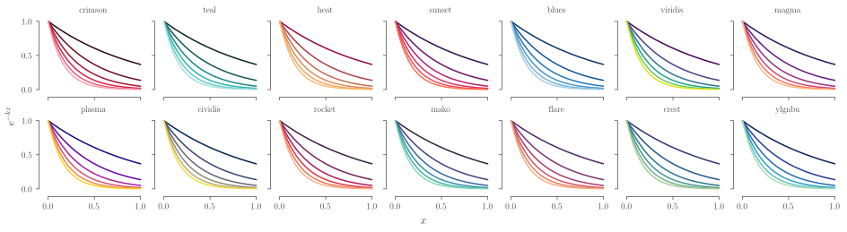
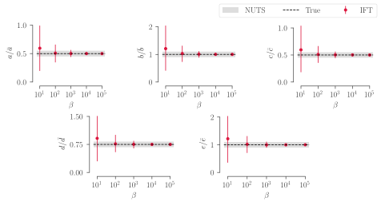
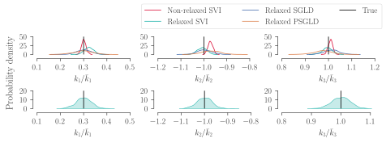
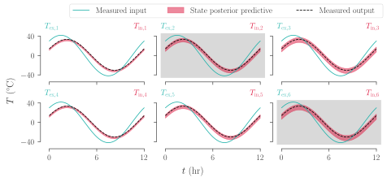
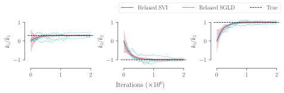
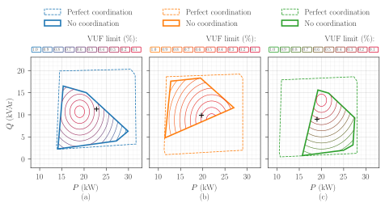
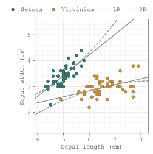

# labfigs

One plotting library for the lab's figures, with a house style modelled on Kairui Hao's thesis figures and a design checklist adapted from Andrey Churkin's [BeautifulFigures](https://github.com/AndreyChurkin/BeautifulFigures/).
It is matplotlib and seaborn underneath: one style call, plus helpers for the elements that keep coming back (posterior bands, sample draws, method ribbons, intervals, heatmaps, colour ramps).
A Claude Code skill in `skill/` teaches an agent to use it, so figures look the same in every project.

## Install

```bash
git clone https://github.com/Jacob-Liam-Albaugh/labfigs.git
```

```bash
pip install -e labfigs
```

Text is set with LaTeX when `latex` is on your PATH, and with matplotlib's own math text otherwise.

In a `uv` project, use it without adding it to the project's dependencies:

```bash
uv run --with-editable path/to/labfigs python scripts/plot.py
```

## Use

```python
import numpy as np
import labfigs as lf

lf.use()
x = np.linspace(0, 1, 200)
truth = np.sin(2 * np.pi * x)
samples = truth * np.random.default_rng(0).normal(1, 0.2, (500, 1))

fig, ax = lf.subplots()
lf.paths(ax, x, samples, label="Posterior draws")
ax.plot(x, truth, color=lf.TRUE, ls="--", label="True")
ax.set(xlabel="$x$", ylabel="$u$", xticks=[0, 0.5, 1], yticks=[-2, -1, 0, 1, 2])
lf.legend_above(ax)
lf.save(fig, "out/first")
```

This writes `out/first.svg`. Figures are vector only; pass `formats=("svg", "pdf")` to `lf.save` when LaTeX needs a PDF. The rules:

- Call `lf.use()` once, before any figure. Do not set fonts, sizes or `rcParams` yourself.
- Make figures with `lf.subplots` and finish them with `lf.save`.
- Use the named colours (`lf.POSTERIOR`, `lf.PREDICTIVE`, `lf.REFERENCE`, `lf.TRUE`), the cycle (`"C0"`, `"C1"`, ...) for methods, and `lf.ramp(n, name)` for ordered sweeps. No hex colours in scripts.
- If a figure needs something the library lacks, add a helper to `labfigs.py` instead of writing it in your script.

The full list of helpers, options and conventions is in [skill/SKILL.md](skill/SKILL.md).

## Examples

```bash
python examples/duffing_311.py
```

```bash
python examples/field.py
```

```bash
python examples/palettes.py
```

```bash
python examples/hao_figures.py
```

```bash
python examples/hao_replicas.py
```

```bash
python examples/feasible_regions.py
```

```bash
python examples/churkin.py
```

Each writes its figure next to the script.

The thesis Fig. 3.11 layout (`duffing_311.py`):


Sample draws, flat and shaded by standard deviations from the mean in every ramp (`field.py`):


A 2D field in every ramp (`field.py`):


Every ramp as a line sweep (`palettes.py`):



The other figure types of Hao's thesis, on synthetic data (`hao_figures.py`). Parameter intervals over a sweep, as in Fig. 3.2:



Densities per method and filled, as in Fig. 6.2 and 4.6:



A grid with shaded panels and two-colour titles, as in Fig. 4.9:



Convergence traces, as in Fig. 6.7:



Three whole figures redrawn on synthetic data (`hao_replicas.py`). Thesis Fig. 6.3, with a zoomed second row:


Filter paper Fig. 14, whole record beside a zoom:


Filter paper Fig. 16:


Feasible regions with nested limit contours, a level key and a fine grid (`feasible_regions.py`):



Churkin's two examples redrawn (`churkin.py`). Markers with darker edges, neutral trend lines and the mono font:



A 3D surface on the dark page, in the sunset ramp:


## Design checklist

Before a figure goes into a paper:

- Say in one sentence what it shows, and plot only the data that supports that sentence.
- Set `lf.subplots(width=)` to the printed width and include the figure unscaled, so the text prints at body-text size. No text below about 8 pt.
- Check it in the compiled manuscript at 100%: font size against the caption, line weights, marker sizes, legend.
- Design in black, grey and line styles first, then add one or two colours. Keep one colour per data subset across every figure.
- Fade the mass of lines to grey and colour only the few that matter.
- Use a ramp for ordered data, never a rainbow. Red reads as wrong and green as right.
- Put the legend at the top, and write a caption that says what to see.
- Vector only: `lf.save` writes SVG. Add `formats=("svg", "pdf")` for LaTeX.
- Avoid pie charts. Use 3D only when the surface's shape is the message (`lf.surface`).
- Expect several rounds of render, look, fix.

The full checklist is in [skill/SKILL.md](skill/SKILL.md).

## References

- Kairui Hao's thesis and filter paper figures: the source of the house style (colours, trimmed spines, legend above).
- Andrey Churkin, [BeautifulFigures](https://github.com/AndreyChurkin/BeautifulFigures/) (MIT): the source of the design checklist, the fine grid (`lf.grid`), the feasible-region example layout, the purple-teal set, the sunset ramp, the dark page, edged markers (`lf.points`) and the 3D surface (`lf.surface`). His two tutorials cover the [principles](https://youtu.be/i-HAjex6VtM) and the [whole process](https://youtu.be/KQ6Zg9B5Mxs), from plotting code to the manuscript page.

## Claude Code skill

Link the skill once and Claude Code will use the library whenever it plots:

```bash
ln -s "$PWD/labfigs/skill" ~/.claude/skills/labfigs
```
