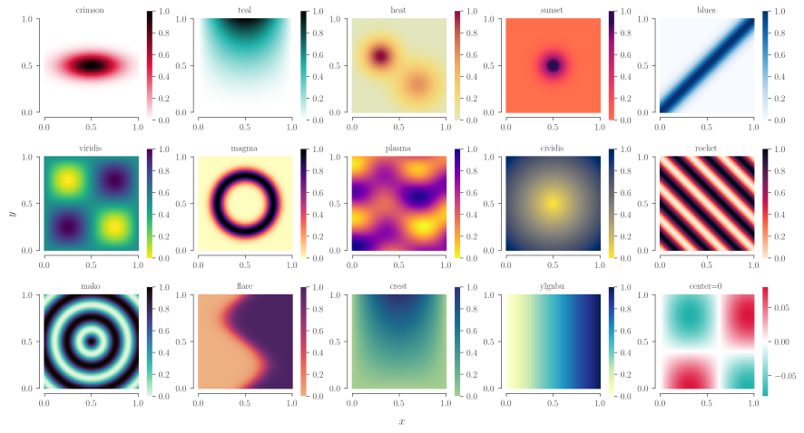
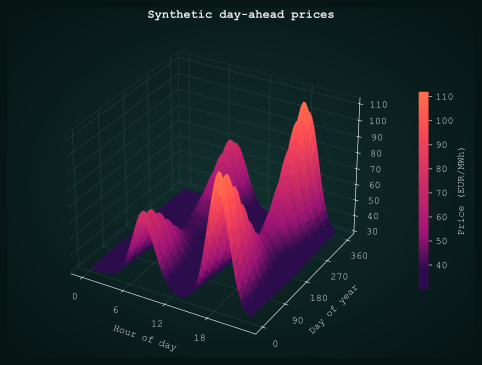
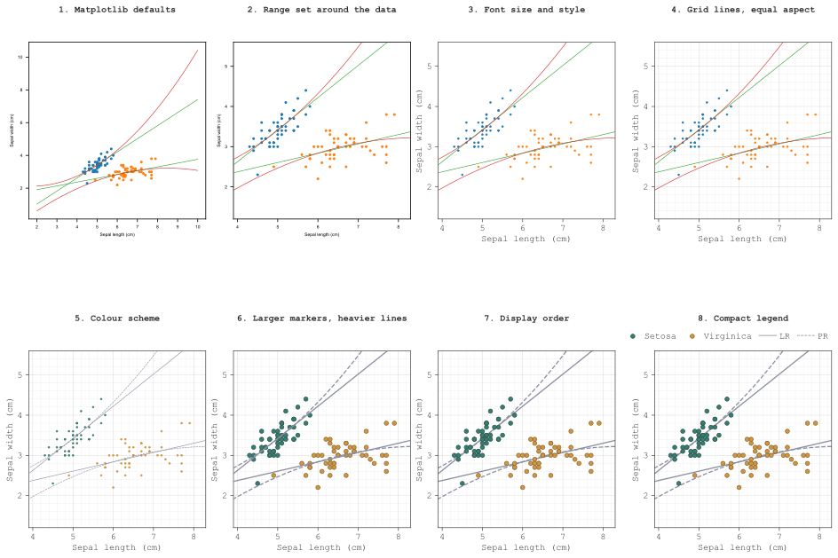

# labfigs

One plotting library for the lab's figures, with a house style modelled on the figures of [Kairui Hao's thesis](https://hammer.purdue.edu/articles/thesis/Information_Field_Theory_Approach_to_Uncertainty_Quantification_for_Differential_Equations_Theory_Algorithms_and_Applications/25665570) and a design checklist adapted from Andrey Churkin's [BeautifulFigures](https://github.com/AndreyChurkin/BeautifulFigures/).
It is matplotlib and seaborn underneath: one style call, plus helpers for the elements that keep coming back (posterior bands, sample draws, method ribbons, intervals, heatmaps, colour ramps).
A Claude Code skill in `skill/` teaches an agent to use it, so figures look the same in every project.

## Install

```bash
git clone https://github.com/Jacob-Liam-Albaugh/labfigs.git
```

```bash
pip install -e labfigs
```

Text is set with LaTeX when `latex` is on your PATH, and with matplotlib's own math text otherwise.

In a `uv` project, use it without adding it to the project's dependencies:

```bash
uv run --with-editable path/to/labfigs python scripts/plot.py
```

## Use

```python
import numpy as np
import labfigs as lf

lf.use()
x = np.linspace(0, 1, 200)
truth = np.sin(2 * np.pi * x)
samples = truth * np.random.default_rng(0).normal(1, 0.2, (500, 1))

fig, ax = lf.subplots()
lf.paths(ax, x, samples, label="Posterior draws")
ax.plot(x, truth, color=lf.TRUE, ls="--", label="True")
ax.set(xlabel="$x$", ylabel="$u$", xticks=[0, 0.5, 1], yticks=[-2, -1, 0, 1, 2])
lf.legend_above(ax)
lf.save(fig, "out/first")
```

This writes `out/first.svg`. Figures are vector only; pass `formats=("svg", "pdf")` to `lf.save` when LaTeX needs a PDF. The rules:

- Call `lf.use()` once, before any figure. Do not set fonts, sizes or `rcParams` yourself.
- Make figures with `lf.subplots` and finish them with `lf.save`.
- Use the named colours (`lf.POSTERIOR`, `lf.PREDICTIVE`, `lf.REFERENCE`, `lf.TRUE`), the cycle (`"C0"`, `"C1"`, ...) for methods, and `lf.ramp(n, name)` for ordered sweeps. No hex colours in scripts.
- If a figure needs something the library lacks, add a helper to `labfigs.py` instead of writing it in your script.

The full list of helpers, options and conventions is in [skill/SKILL.md](skill/SKILL.md).

## Examples

Each script in `examples/` writes its SVG figures next to itself. Figures credited to Kairui Hao or Andrey Churkin are not copies of theirs: each is remade with labfigs on synthetic data, and the credit links to the original.

```bash
for script in examples/*.py; do python "$script"; done
```

The house layout: a posterior band, predictive draws, the truth and a forecast split (`duffing_311.py`). Remade with labfigs after Fig. 3.11 of [Hao's thesis](https://hammer.purdue.edu/articles/thesis/Information_Field_Theory_Approach_to_Uncertainty_Quantification_for_Differential_Equations_Theory_Algorithms_and_Applications/25665570):


A 2D field in every ramp (`field.py`):



Regions with nested contours, a level key and a fine grid (`feasible_regions.py`). Remade with labfigs after Churkin's [main example](https://github.com/AndreyChurkin/BeautifulFigures/tree/main/01_main_simple_example):


A 3D surface on the dark page (`churkin.py`). Remade with labfigs after Churkin's [3D price surface](https://github.com/AndreyChurkin/BeautifulFigures/tree/main/02_3d_price_surface):



The eight design steps from the matplotlib default to the finished figure (`design_steps.py`). Remade with labfigs after the iterative design process figure in Churkin's [BeautifulFigures README](https://github.com/AndreyChurkin/BeautifulFigures#readme):



The rest are in [examples/](examples): [gradient draws](examples/gradient_draws.svg), [ramps as line sweeps](examples/palettes.svg), [parameter intervals](examples/intervals.svg), [densities](examples/densities.svg), [shaded panels](examples/shaded_panels.svg), [convergence traces](examples/convergence.svg), three of Hao's figures remade with labfigs ([6.3](examples/fig_6_3.svg) of the [thesis](https://hammer.purdue.edu/articles/thesis/Information_Field_Theory_Approach_to_Uncertainty_Quantification_for_Differential_Equations_Theory_Algorithms_and_Applications/25665570), [14](examples/fig_14.svg) and [16](examples/fig_16.svg) of the [filter paper](https://arxiv.org/abs/2407.16502)), an [edged scatter](examples/edged_scatter.svg) after Churkin's [main example](https://github.com/AndreyChurkin/BeautifulFigures/tree/main/01_main_simple_example) the [muted colour combinations](examples/combos.svg) in `lf.COMBOS` and its [diverging, cyclic and colour-blind-safe schemes](examples/schemes.svg).

## Design checklist

Before a figure goes into a paper:

- Say in one sentence what it shows, and plot only the data that supports that sentence.
- Set `lf.subplots(width=)` to the printed width and include the figure unscaled, so the text prints at body-text size. No text below about 8 pt.
- Check it in the compiled manuscript at 100%: font size against the caption, line weights, marker sizes, legend.
- Design in black, grey and line styles first, then add one or two colours. Keep one colour per data subset across every figure.
- No neon. Complementary colours are fine at moderate saturation (`lf.combos(2, vivid=0.5)`); colours that must be told apart differ in hue, not only in lightness.
- Fade the mass of lines to grey and colour only the few that matter.
- Use a ramp for ordered data, never a rainbow. Red reads as wrong and green as right.
- Put the legend at the top, and write a caption that says what to see.
- Vector only: `lf.save` writes SVG. Add `formats=("svg", "pdf")` for LaTeX.
- Avoid pie charts. Use 3D only when the surface's shape is the message (`lf.surface`).
- Expect several rounds of render, look, fix.

The full checklist is in [skill/SKILL.md](skill/SKILL.md).

## References

- Kairui Hao, *Information Field Theory Approach to Uncertainty Quantification for Differential Equations: Theory, Algorithms and Applications*, PhD thesis, Purdue University ([Purdue Hammer](https://hammer.purdue.edu/articles/thesis/Information_Field_Theory_Approach_to_Uncertainty_Quantification_for_Differential_Equations_Theory_Algorithms_and_Applications/25665570), [ProQuest](https://www.proquest.com/docview/3235007366)), and his [filter paper](https://arxiv.org/abs/2407.16502): the source of the house style (colours, trimmed spines, legend above).
- Andrey Churkin, [BeautifulFigures](https://github.com/AndreyChurkin/BeautifulFigures/) (MIT): the source of the design checklist, the fine grid (`lf.grid`), the feasible-region example layout, the purple-teal set, the sunset ramp, the dark page, edged markers (`lf.points`) and the 3D surface (`lf.surface`). His two tutorials cover the [principles](https://youtu.be/i-HAjex6VtM) and the [whole process](https://youtu.be/KQ6Zg9B5Mxs), from plotting code to the manuscript page.
- Sanzo Wada, *A Dictionary of Color Combinations*, browsed at [colors.elwyn.co](https://colors.elwyn.co) and taken from Matt DesLauriers' [dataset](https://github.com/mattdesl/dictionary-of-colour-combinations) (MIT): the 348 numbered combinations in `lf.COMBOS`.
- [ColorSchemes.jl](https://github.com/JuliaGraphics/ColorSchemes.jl) (MIT), as listed in the [Plots.jl docs](https://docs.juliaplots.org/stable/generated/colorschemes/): the named schemes in `lf.COMBOS` (sequential, diverging, cyclic), among them Fabio Crameri's [Scientific colour maps](https://doi.org/10.5281/zenodo.1243862) (MIT), cmocean (MIT) and ColorBrewer (Apache 2.0).
- Paul Tol, [colour schemes](https://sronpersonalpages.nl/~pault/) (BSD 3-Clause): the colour-blind-safe series sets `tol_bright` and `tol_muted`.

## Licence

labfigs is under the [MIT licence](LICENSE). The licences of the material it adapts are in [NOTICE](NOTICE). Figures made with it can be published without restriction; a paper that uses one of Crameri's schemes (listed in NOTICE: `devon`, `vik`, `acton` and others) should cite his [Scientific colour maps](https://doi.org/10.5281/zenodo.1243862).

## Claude Code skill

Link the skill once and Claude Code will use the library whenever it plots:

```bash
ln -s "$PWD/labfigs/skill" ~/.claude/skills/labfigs
```
